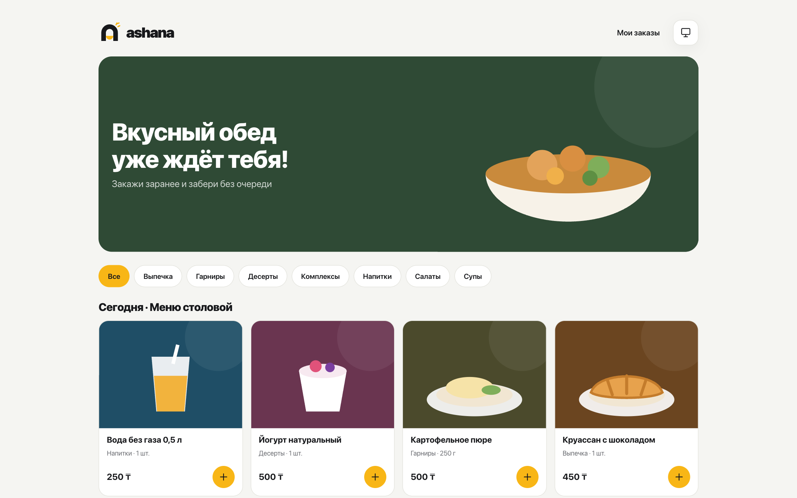
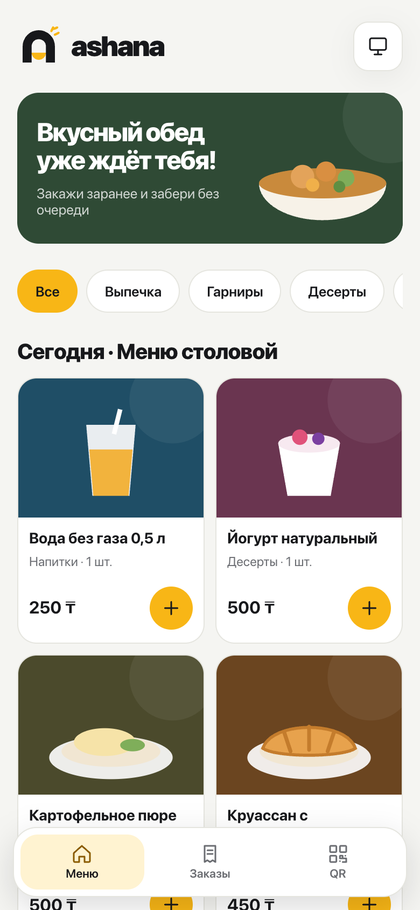
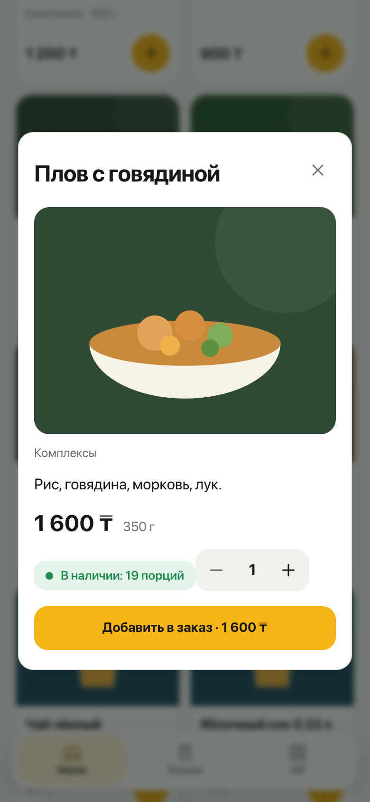
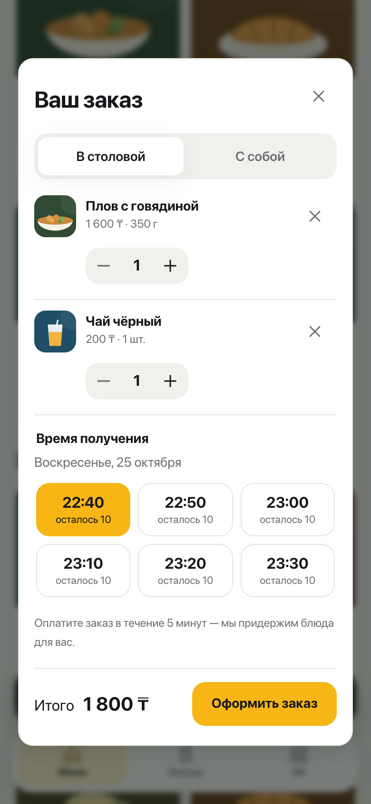
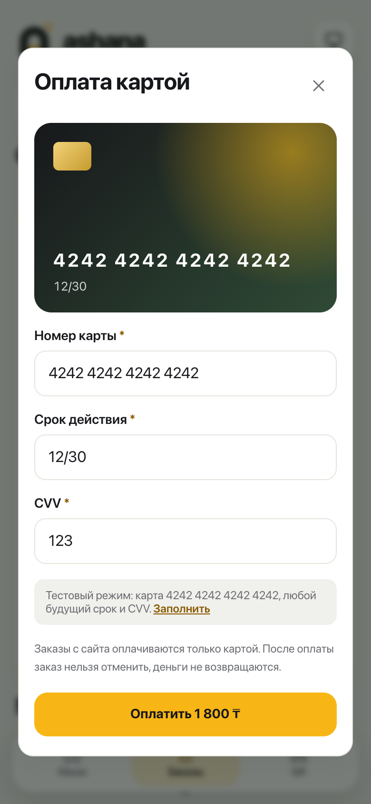
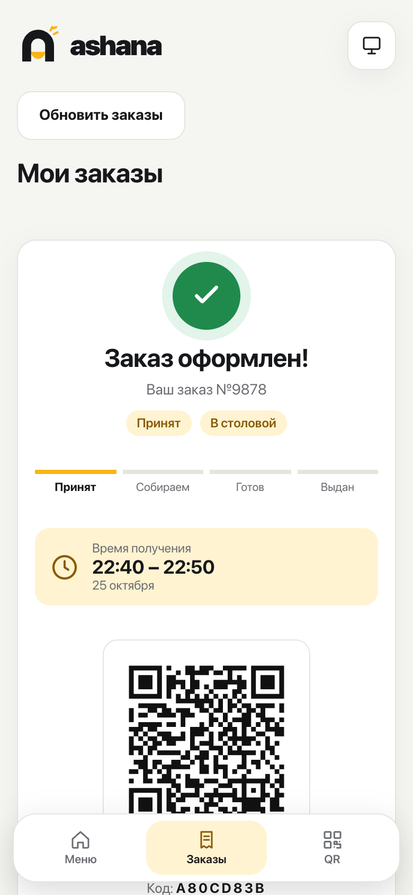
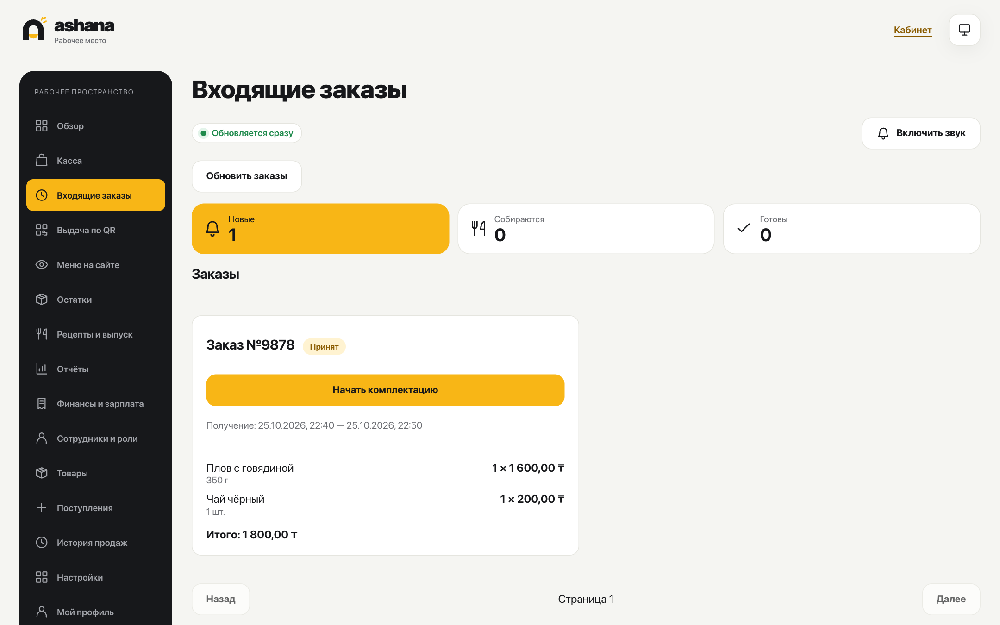
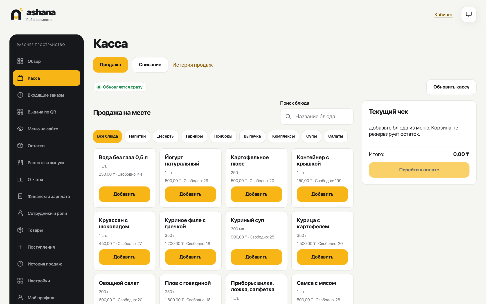
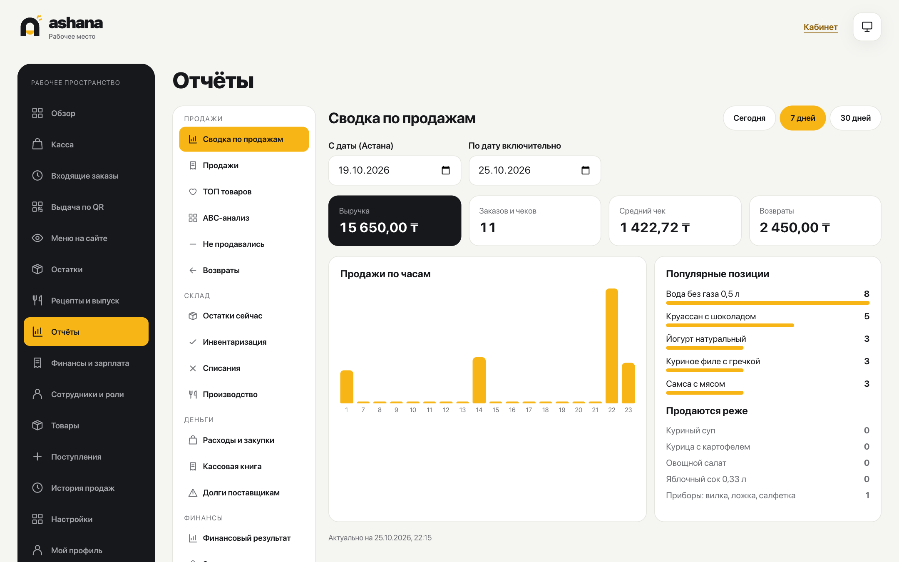
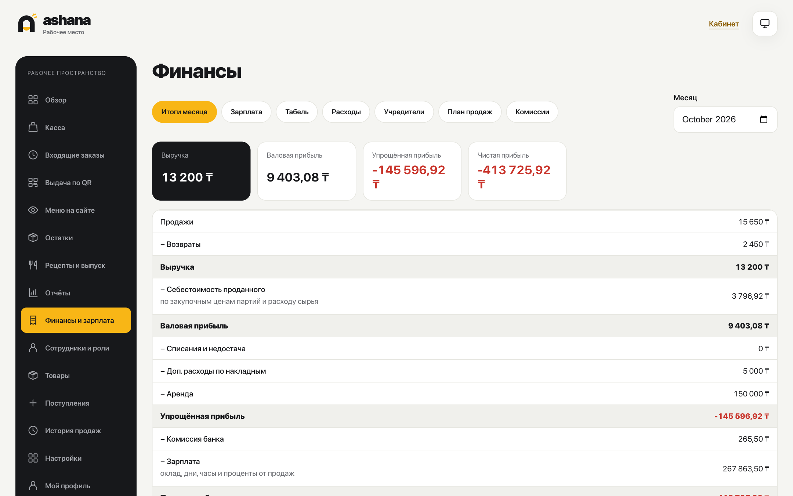

# AsHana

### Order ahead, skip the line — and run the whole canteen from one workspace.


-8A5B00)


**[Quick start](docs/engineering/quick-start.md)** · **[Architecture](docs/architecture/overview.md)** · **[Decision records](docs/architecture/decisions/README.md)** · **[Documentation](docs/README.md)**

> AsHana runs locally and is demonstrated in Google Chrome. Payments are simulated: only published test cards are accepted and no real money moves. Everything else — menu, stock, kitchen, till, reports and payroll — works for real on a real PostgreSQL database.



AsHana is a pre-order and back-office system for a canteen in Kazakhstan. Students order lunch on the website before the break, pay online and pick the meal up at the counter by QR code — no queue. Staff run the kitchen, the till, the stock, production, reports and payroll in one Russian-language workspace that updates live.

No accounts for guests. No paper. One stock shared by the website and the till, so the last portion is never sold twice.

## Preview

**Guest site**

| Menu | Dish | Cart and pickup time | Test card | QR ticket |
| :---: | :---: | :---: | :---: | :---: |
|  |  |  |  |  |

**Staff workspace**

| Incoming orders | Till |
| :---: | :---: |
|  |  |
| **Reports** | **Finance and payroll** |
|  |  |

## Features

**For guests**

- **Order ahead:** today's and tomorrow's menu, categories, dish photos, portion sizes and live availability.
- **Pickup slots:** 10-minute windows with capacity; portions are held for 5 minutes while the guest pays.
- **Eat in or takeaway:** takeaway adds cutlery and packaging the guest picks and pays for.
- **Mock card payment:** a realistic card form that accepts only test cards; card data never leaves the browser.
- **QR pickup:** a ticket with the pickup code; the order status changes live — *accepted → preparing → ready → handed over*.
- **No account needed:** the guest is recognised by a private cookie; a phone number is never required.

**For staff**

- **Kitchen screen:** new paid orders appear instantly with a signal; orders are sorted by pickup time.
- **Counter and QR scanner:** hand over an order by scanning the guest's QR code, exactly once.
- **Till:** counter sales from the same stock as the website, receipt history and returns of counter sales.
- **Stock:** batches with expiry dates, supplier invoices with extra costs, write-offs, stock counts and supplier debts.
- **Recipes and production:** versioned recipes, actual ingredient use and real output; cooked food becomes a sellable batch.
- **Menu:** meal periods, published dishes, and always-on goods that stay on sale while stock lasts.
- **Reports:** sales summary, sales by dish, top dishes, ABC analysis, unsold items, returns, stock, counts, write-offs, production, purchases, cash book and supplier debts.
- **Finance and payroll:** monthly profit and loss (simple and full profit), bank fees, expenses, sales plan, owners and dividends; salary as monthly, daily, hourly, % of sales and % of profit; timesheets, advances and the balance owed.
- **People and access:** staff log in with a login and password from the administrator; editable roles; block, delete, reset a forgotten password.

**House rules built into the system**

- Website orders are paid online only and are never refunded.
- A paid order not collected 60 minutes after its slot becomes *Not collected*; the money stays, the portions go back on sale.
- Returns happen only at the till, and only for goods sold at the till.

## Design

A warm, quick, mobile-first interface: the guest site is built for a phone in a lunch queue, the workspace for a counter tablet and an office desktop.

- **Accent:** canteen yellow (`#F8B616`) for primary actions; dark ink (`#17181B`) for navigation and key figures.
- **Surfaces:** soft off-white background (`#F5F5F2`) with white cards; a full dark theme (`#0E0F11`) follows the device or the user's choice.
- **Typography:** a system font stack (Inter or SF Pro when available); prices and totals set large and bold.
- **Food art:** every dish has a drawn illustration until a real photo is uploaded.
- **Language:** the entire interface, errors and empty states are in Russian; dates and money follow Kazakhstan (Astana time, tenge).
- **Accessible:** keyboard navigation, visible focus, password visibility toggles, readable contrast in both themes.

## Technical Shape

A modular monolith with Clean Architecture. Business rules do not know about FastAPI or SQL.

```
backend/src/ashana/
├── modules/                 10 business modules
│   └── <module>/
│       ├── domain/          rules and data, plain Python
│       ├── application/     use cases + ports (Protocol interfaces)
│       ├── infrastructure/  PostgreSQL implementation of the ports
│       └── presentation/    HTTP routes (FastAPI)
├── shared/                  shared kernel: BusinessError, Result
└── bootstrap/               wiring, settings, HTTP helpers, CLI
frontend/src/
├── pages/  features/  shared/{api,ui,lib,locales}
```

- **Modules:** identity, inventory, production, catalog, orders, pos, reporting, finance, notifications, realtime.
- **Consistency:** each operation runs in one Unit of Work; idempotency keys make retries safe; row and advisory locks guarantee that the last portion goes to exactly one buyer.
- **Audit by design:** stock movements, sales, payments and money records are append-only; corrections are new records.
- **Live updates:** PostgreSQL `LISTEN/NOTIFY` → in-process hub → WebSocket to the kitchen, the till and each guest's own orders.
- **Notifications:** a transactional outbox for Telegram messages to staff (connected by the owner with a bot token).
- **Security:** HttpOnly session cookies, CSRF protection, Argon2 password hashing, login rate limits, a least-privilege database role that cannot delete history, photos re-encoded to WebP without metadata.
- **Database:** PostgreSQL 17 with 20 Alembic migrations applied automatically on start.
- **Frontend:** React 19 + TypeScript (strict) + Vite, typed API client generated from OpenAPI, CSS design tokens.
- **Quality:** 163 backend tests against a real PostgreSQL (including concurrency races and load), 74 Vitest component tests, 34 Playwright end-to-end scenarios in Google Chrome; ruff, mypy, ESLint, Prettier.
- **Operations:** one-command Docker Compose stand, demo data seeding, backup and verified restore scripts.

## Getting Started

You need Git and Docker Desktop.

```bash
git clone git@github.com:aribzhan-dev/AsHana.git
cd AsHana
cp .env.example .env        # put three different random passwords into .env
docker compose up --build --detach --wait --wait-timeout 180
docker compose exec api python -m ashana.bootstrap.admin
```

Then open:

| Address | What it is |
| --- | --- |
| http://127.0.0.1:8080 | Guest site: menu, cart, payment, QR ticket |
| http://127.0.0.1:8080/admin | Staff workspace (not linked from the site) |
| http://127.0.0.1:8000/api/docs | API documentation |

Test card: `4242 4242 4242 4242`, any future date, any CVV. Demo goods and a 7-day menu: `python3 -I scripts/seed_demo.py`.

Step-by-step guide with explanations and common problems (in Russian): **[docs/engineering/quick-start.md](docs/engineering/quick-start.md)**.

## Roadmap

- [x] Guest menu, cart, pickup slots and portion reservation
- [x] Mock card payment and QR pickup
- [x] Stock ledger with batches, invoices, write-offs and counts
- [x] Versioned recipes and production
- [x] Till with shared stock and counter returns
- [x] Live kitchen, till and guest screens (WebSocket)
- [x] Reports and the sales dashboard
- [x] Finance: profit and loss, expenses, plans, dividends
- [x] Payroll: salary schemes, timesheets, advances
- [x] Dish photos
- [x] Staff management: roles, blocking, password reset
- [x] Backup, restore check and load testing
- [ ] Telegram notifications live (code ready, needs the canteen's bot token)
- [ ] Pilot in a real canteen
- [ ] Payroll taxes, month closing and accounting export

## Privacy

Guests have no accounts and are never asked for personal data; their orders are tied to a private cookie. Staff records keep only a name, login, role and optional contacts. Reports and staff screens never show pickup codes or guest identifiers. Passwords, the `.env` file, admin credentials and database backups are local only and excluded from the repository.

## Documentation

Detailed documentation is in Russian:

- [Requirements](docs/product/requirements.md) and [user flows](docs/product/user-flows.md)
- [Architecture overview](docs/architecture/overview.md) and [module system](docs/architecture/module-system.md)
- [Architecture decision records](docs/architecture/decisions/README.md) — why things are built this way
- User guides: [orders](docs/engineering/orders-usage.md), [kitchen](docs/engineering/kitchen-usage.md), [till](docs/engineering/pos-usage.md), [stock](docs/engineering/inventory-usage.md), [production](docs/engineering/production-usage.md), [menu](docs/engineering/catalog-usage.md), [reports](docs/engineering/reporting-usage.md), [finance](docs/engineering/finance-usage.md), [staff workspace](docs/engineering/workspace-usage.md)
- [Local development and checks](docs/engineering/local-development.md) and [testing](docs/engineering/testing.md)

## License

All rights reserved. This repository does not grant rights to copy, redistribute or reuse the code, design or content.
