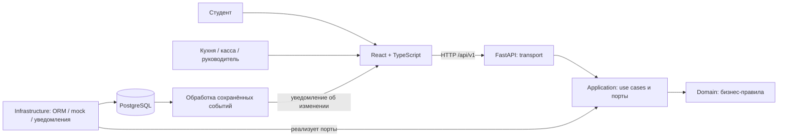

# Архитектура

Стек подтверждён владельцем; описанная структура — **предложение**, подготовленное для реализации.
Один модульный монолит backend, один React frontend с экранами по ролям, одна PostgreSQL.
Это позволяет атомарно сохранить заказ и резерв без распределённых транзакций.

Диаграмма показывает роли компонентов, а не разрешение любых импортов.
Domain — чистые Python-объекты и исключения без ORM/HTTP. Application использует domain и интерфейсы
репозиториев/Unit of Work/clock/payment. Infrastructure реализует эти порты.
Presentation преобразует HTTP в команды use cases и результаты в DTO.
Composition root связывает реализации через FastAPI dependencies.

Внутри модуля: `domain/`, `application/`, `infrastructure/`, `presentation/`.
Не создавать универсальные BaseService/BaseRepository только ради шаблона.
Межмодульное взаимодействие — явные application contracts, без импорта чужих ORM-моделей.
Заказ, склад и слот могут участвовать в одной транзакции через общую UoW и соответствующие порты.

Альтернатива — микросервисы — увеличивает сложность резервирования, отладки и эксплуатации;
на первом этапе не оправдана. Цена монолита: совместный деплой и необходимость контролировать импорты.
См. [ADR](decisions/README.md), [границы модулей](module-system.md), [владение данными](data-ownership.md).
